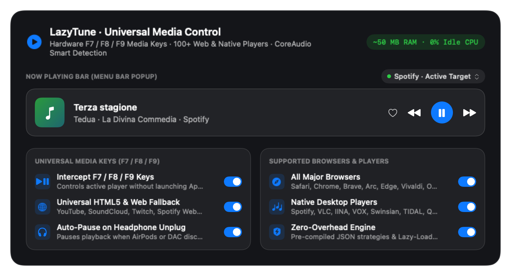

<h3>LazyTune</h3>

**All-in-one macOS per-app audio mixer and universal media key controller (`F7` / `F8` / `F9`).**
Control the volume of every app independently, route audio to different speakers, and control playback across **Spotify, YouTube, SoundCloud, Twitch, Safari, Chrome, Brave, Arc, VLC, IINA**, and **100+ web players** without macOS ever launching Apple Music by mistake. Engineered for minimal resource usage (**~50 MB RAM**, **0.0% idle CPU**, lazy-loaded EQ, and zero background update telemetry).

<br clear="all"/>

<p align="center">
  <a href="https://github.com/Vic3z/LazyTune"></a>
  <a href="LICENSE"></a>
  <a href="https://www.apple.com/macos/"></a>
  
  
</p>

<p align="center">
  
</p>

<p align="center">
  
</p>

---

## ✨ What's New in LazyTune

### 🎵 Universal Media Keys (`F7` / `F8` / `F9`) & Web/Native Player Control
- **Universal `F7` (Previous), `F8` (Play/Pause), `F9` (Next)** — Hardware media keys control whichever media player or browser tab is currently active, without ever waking or launching Apple Music when it's closed.
- **CoreAudio-Aware Smart Target Resolution** — LazyTune combines browser/player inspection with its real-time CoreAudio process tap to automatically know which tab or app is actually producing sound right now.
- **Now Playing Mini-Player in Menu Bar** — View current track title, artist, album, and artwork directly at the top of the popup, with instant Play/Pause, Next, Previous, Favorite/Like, Bring-to-Front, and a target selector menu to pin any open player or browser tab.
- **103 Built-in Web Media Adapters + Universal HTML5 Fallback** — Works out of the box with **YouTube, YouTube Music, SoundCloud, Spotify Web, Twitch, Bandcamp, Netflix, Tidal, Deezer, MixCloud, Apple Podcasts, Coursera, Udemy**, and any website with an HTML5 `<video>` or `<audio>` element across **Safari, Google Chrome, Brave, Arc, Microsoft Edge, Vivaldi, Orion, and Opera**.
- **Native Desktop Players** — Native control and real-time push notifications (`DistributedNotificationCenter`) for **Spotify, VLC, IINA, VOX, Swinsian, TIDAL, Qobuz, Deezer, Amazon Music, and Apple Music**.
- **Auto-Pause on Headphone Unplug & Sleep** — Automatically pauses active playback when Bluetooth headphones (AirPods, Sony, Bose) or external USB DACs disconnect, or when your Mac goes to sleep.
- **Tahoe Now Playing HUD** — Optional on-screen glass HUD displaying track metadata and playback state transitions when pressing media keys or switching players.

### ⚡ Ultra-Lightweight & Zero-Overhead Engine
- **~50 MB RAM Footprint (-76% vs upstream)** — All 103 web media strategies are pre-compiled into a static JSON bundle (`MediaStrategies.json`), completely eliminating `JavaScriptCore` (`WebKit malloc`) from runtime memory.
- **0.0% Idle CPU** — Uses native macOS push notifications (`DistributedNotificationCenter`) and in-memory CoreAudio peak levels instead of background AppleScript polling; pauses UI VU-meter timers completely while the popup is closed.
- **Lazy-Loaded EQ & AutoEQ** — The 10-band biquad filter banks and the 6,000+ headphone AutoEQ catalog consume **0 bytes of RAM and 0% CPU** unless you explicitly enable EQ or open the AutoEQ picker.
- **Zero Background Update Checks** — `Sparkle.framework` background update telemetry is completely removed.

---

## 🚀 Build & Install

### Build from Source (No full Xcode.app required — works with Command Line Tools)

```bash
git clone https://github.com/Vic3z/LazyTune.git
cd LazyTune
./scripts/build-local-app.sh
cp -R build/LazyTune.app /Applications/LazyTune.app
open /Applications/LazyTune.app
```

---

## 🛠 Full Feature Overview

### 🎚 Per-App Audio Mixer & Routing
- **Per-app volume & mute** — Individual sliders and mute toggles for each running application
- **Per-app volume boost** — `1x / 2x / 3x / 4x` gain boost for quiet apps or videos
- **Multi-device output & per-app routing** — Send specific apps to different audio outputs (e.g. music to speakers, calls to headphones) or route to multiple devices simultaneously
- **Device priority & auto-restore** — Automatically switch to your preferred output/input device when connected and restore per-app settings on reconnect
- **Smart volume backend (Hardware / DDC / Software)** — Control volume on built-in speakers, Bluetooth headphones, USB DACs, and external HDMI/DisplayPort monitors (via DDC)

### ⌨️ Global Shortcuts & URL Automation
- **Global hotkeys** — Configurable shortcuts for Play/Pause, Next, Previous, Like/Favorite, Switch Active Media Player, Pin Active Tab, Show Track Info HUD, App Volume Up/Down/Mute, and Toggle Popup
- **URL schemes (`lazytune://` & `finetune://`)** — Automate playback and mixer actions from Raycast, Alfred, Apple Shortcuts, or shell scripts:
  ```bash
  open "lazytune://media-play-pause"
  open "lazytune://media-next"
  open "lazytune://media-previous"
  open "lazytune://media-switch-player"
  ```

### 🎛 Lazy-Loaded EQ & Audio Shaping
- **10-band graphic EQ** — 20 built-in presets + custom per-app presets (allocated only when enabled)
- **AutoEQ headphone correction** — On-demand search across 6,000+ headphone profiles or custom `ParametricEQ.txt` import
- **ISO 226:2023 Loudness Compensation** — Optional equal-loudness contour compensation at low listening volumes

---

## 📋 Requirements

- **macOS 15.4** or later (Apple Silicon)
- **Audio Capture Permission** (prompted on first launch for per-app volume mixing)
- **Automation / Apple Events Permission** (prompted when controlling Spotify or browser tabs)

---

## 🙏 Credits & Acknowledgments

- **LazyTune** is developed and maintained by **[Vic3z](https://github.com/Vic3z)**.
- Forked from and built upon the core audio mixer architecture of **[FineTune](https://github.com/ronitsingh10/FineTune)** by **Ronit Singh**.

## 📄 License

Released under the [GNU General Public License v3.0 (GPL-3.0)](LICENSE).
